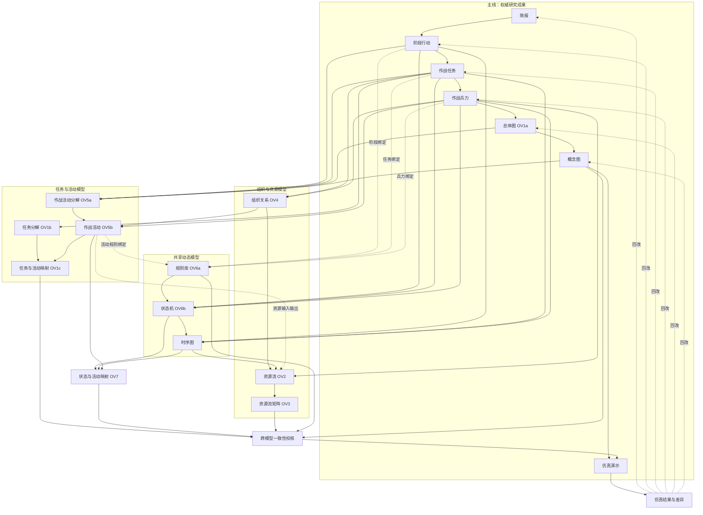

# 七步主线与关联模型拓扑开发规范

更新时间：2026-08-18

状态：目标架构已确认，尚未实现

用途：指导开发大模型完成流程切割、模型关联、失效传播和验收

## 1. 文档效力

实施本次流程切割时，以本文为目标架构。`RESEARCH_WORKFLOW_18.md` 保留为旧版流程与当前实现记录；其导航顺序、页面式辅助步骤和五阶段分组不再作为本次改造目标。

开发大模型必须先读取：

1. `AGENTS.md`
2. `project-context.md`
3. 本文
4. `OV6_PRODUCT_MODEL.md`

本文描述的是待实施目标，不得把文档完成误报为代码已实现或已验收。

## 2. 改造目标

把当前不断增长的线性页面流程切成两层：

- **主线**：用户必须依次形成并确认的七项权威成果。
- **关联模型**：围绕主线成果生成、复核、映射和诊断的模型视图，不再占用主线编号。

目标不是隐藏旧菜单，而是建立可追溯的数据拓扑：每个派生成果都有来源，每个绑定都能定位对象，每次上游变更都能准确标记受影响内容。

## 3. 七步主线

左侧原“研究路径”位置只显示以下七步：

| 顺序 | 页面/资源建议 | 显示名称 | 权威内容 | 进入下一步条件 |
|---|---|---|---|---|
| 01 | `brief` | 简报 | 研究意图、目标、边界、假设、效果、风险、证据 | 简报必填项完整 |
| 02 | `phase-action` | 阶段行动 | 阶段、双方行动、进入/退出条件 | 阶段行动已人工确认 |
| 03 | `operational-task` | 作战任务 | 阵营、阶段、任务类型、任务区域、目标、效果 | 作战任务已人工确认 |
| 04 | `force-mission` | 作战兵力 | 概念兵力、作战兵力、任务承接、平台引用 | 作战兵力已人工确认 |
| 05 | 复用 `ov1` | 总体图（OV1a） | 高层主体、总体关系、作战构想闭环 | 总体图已人工确认或接受当前修订 |
| 06 | `concept-map` | 概念图 | 已确认阶段、兵力和总体关系的空间化表达 | 概念图研究参考已确认 |
| 07 | 优先复用 `scenario` 作为容器 | 仿真演示 | 仿真输入、运行演示、结果校核 | 终点，不再解锁研究步骤 |

约束：

- `workflowPrimaryStepIds` 只能包含上述七项。
- 总体图必须位于概念图之前：总体图给出语义骨架，概念图负责空间化表达。
- `validate` 应并入仿真演示内部的“结果校核”，不再作为左侧步骤。
- `structure-review` 应改为关联模型问题汇总入口。
- `collaboration`、`report` 保留为顶部工具或成果操作，不进入主线。
- 不删除已有资源键，不因界面名称变化批量改写存量数据。

## 4. 关联模型归属

关联模型统一由“关联模型”入口打开；进入具体主线页面时，只显示与该页有关的快捷入口。

| 主线锚点 | 关联模型 |
|---|---|
| 阶段行动 | 规则库 OV6a、状态机 OV6b、时序图 |
| 作战任务 | 任务分解 OV1b、规则库 OV6a、状态机 OV6b、时序图 |
| 作战兵力 | 组织关系 OV4、资源流 OV2、资源流矩阵 OV3、规则库 OV6a、状态机 OV6b、时序图 |
| 总体图 / 概念图 | 作战活动分解 OV5a、作战活动 OV5b |
| 跨模型校核 | 任务与作战活动映射 OV1c、状态与活动映射 OV7 |

活动树不再作为入口或独立成果。OV5a 使用分解清单、层级表或父子关系编辑表达，不再提供活动树页面。

### 4.1 导航行为

- 左侧主线底部设置固定“关联模型”入口，可显示待复核、已过期或有冲突的数量。
- 关联模型入口打开分组抽屉或模型中心，不替换右侧对象属性/知识上下文面板。
- 关联模型不编号，不提供线性的“下一步”。
- 关联模型状态统一为：`empty`、`draft`、`pending_review`、`confirmed`、`stale`、`conflict`。
- 从不同主线页面进入同一模型时，只改变过滤上下文，不复制资源。

### 4.2 共享动态模型禁止复制

规则库、状态机、时序图各只有一套正式资源：

- 从阶段行动进入：按阶段及阶段行动过滤。
- 从作战任务进入：按任务过滤，并显示任务对应的阶段上下文。
- 从作战兵力进入：按兵力过滤，并显示兵力承接的任务和阶段上下文。

任一入口编辑后，其他入口必须立即读取同一修订。禁止生成 `phaseRules`、`taskRules`、`forceRules` 三套互相漂移的数据。

### 4.3 上下文关联流程（强制规范）

左侧七步主线只回答“整个研究进行到哪一步”。用户进入某个主线大步编辑时，必须在该页面工作区内展示当前大步的**上下文关联流程**，回答“当前成果还关联哪些模型、依赖方向是什么、哪些内容需要处理”。

上下文关联流程不是普通快捷按钮栏，必须满足：

- 显示当前大步、关联模型节点、分支和依赖箭头。
- 只呈现与当前大步有关的局部拓扑，不一次铺开全部模型。
- 当前大步和当前编辑对象高亮；离开大步后，该局部流程随页面切换。
- 每个模型节点显示当前对象范围内的状态，而不是只显示全项目总状态。
- 节点可进入对应模型编辑；返回时恢复原主线页面、对象选择和合理的页面位置。
- 进入共享 OV6 模型时携带过滤上下文，不创建副本。
- 未选择具体对象时显示大步级汇总；选中阶段、任务或兵力后自动收窄到对象级关系。
- 局部流程不增加主线编号，也不改变“下一步”的七步推进规则。

页面内建议放置在主线页标题/工具栏下方、核心编辑区上方，作为紧凑的局部流程带。桌面端可横向或分支排列；窄屏改为纵向分组，禁止依靠缩小文字塞入一行。

#### 4.3.1 各大步必须展示的局部流程

| 当前大步 | 上下文关联流程 |
|---|---|
| 简报 | 不强制展示模型流程；继续显示知识来源、引用和研究基线 |
| 阶段行动 | `阶段行动 → 规则库 OV6a → 状态机 OV6b → 时序图` |
| 作战任务 | 分支一：`作战任务 → 任务分解 OV1b`；分支二：`作战任务 → 规则库 OV6a → 状态机 OV6b → 时序图` |
| 作战兵力 | 分支一：`作战兵力 → 组织关系 OV4 → 资源流 OV2 → 资源流矩阵 OV3`；分支二：`作战兵力 → 规则库 OV6a → 状态机 OV6b → 时序图` |
| 总体图 / 概念图 | `总体图 OV1a → 概念图 → 作战活动分解 OV5a → 作战活动 OV5b`，并显示通往 OV1c、OV7 的映射分支 |
| 仿真演示 | `跨模型校核 → 仿真输入编译 → 运行/演示 → 结果校核 → 回改来源` |

总体图和概念图可以共享同一条局部流程，但必须按当前页面高亮 OV1a 或概念图节点。OV1c 分支由任务分解和作战活动共同汇入；OV7 分支由状态机、时序图和作战活动共同汇入，不能画成只有单一来源的线性步骤。

#### 4.3.2 局部状态计算

上下文节点状态由“资源状态 + 当前对象关联状态”共同计算。例如：

- 规则库整体已确认，但当前任务尚无 `taskBindings`：该任务上下文显示“待关联”。
- 状态机产品已有多台机器，但当前兵力没有 `subjectType=force` 的机器：显示“未生成”。
- 时序图存在，但没有包含当前任务/兵力参与方：显示“待关联”。
- OV2 已确认，但当前兵力没有有效交换：显示“覆盖不足”。
- 来源修订变化：显示“已过期”，保留进入查看和重新生成候选的入口。

建议把局部状态归一化为：`not_applicable`、`empty`、`partial`、`pending_review`、`confirmed`、`stale`、`conflict`。全局模型抽屉可以汇总这些对象级状态，但不能反过来用一个全局状态覆盖局部判断。

#### 4.3.3 进入与返回上下文

打开关联模型时至少传递以下导航上下文：

```json
{
  "mainViewId": "operational-task",
  "focusType": "task",
  "focusId": "task-001",
  "relatedViewId": "ov6b"
}
```

返回主线时必须恢复 `mainViewId + focusType + focusId`。滚动位置只作为易失 UI 状态保存，不写入正式项目资源。若来源对象已被删除，返回所属大步并显示引用失效诊断，不跳到无关默认页面。

#### 4.3.4 三层导航边界

| 层级 | 作用 | 是否线性推进 |
|---|---|---|
| 左侧七步主线 | 整体研究进度和权威成果确认 | 是 |
| 大步内上下文关联流程 | 当前大步的局部依赖、状态和对象级入口 | 否 |
| 全局关联模型入口 | 跨大步浏览全部模型、问题和过期状态 | 否 |

三层必须共享同一套路由、资源修订和状态计算。禁止为局部流程另建一套页面状态或持久化模型。

## 5. 完整模型拓扑



## 6. 关系类型与传播规则

完整拓扑必须区分三类边，不能把所有关联都当成生成依赖。

| 类型 | 含义 | 上游变更后的行为 |
|---|---|---|
| `derived_from` | 下游内容由上游生成或编译 | 下游标记 `stale`，保留人工内容，等待重新生成/复核 |
| `binds_to` | 两个既有对象之间的引用或约束 | 不重生成对象；引用缺失时将绑定标记 `stale/conflict` |
| `feedback_to` | 校核或仿真发现的问题回到权威来源 | 只创建诊断和回改建议，不自动覆盖来源 |

禁止因为反馈边形成循环失效。例如 OV5b 可提示 OV2 补资源输入输出，但 OV5b 变更不能自动重写 OV2；只能把相关交换标记为待复核。

## 7. 数据权威与关系所有权

| 内容 | 权威资源 | 关系所有权 |
|---|---|---|
| 简报 | `brief` | 研究边界、效果和风险 |
| 阶段行动 | `phaseActionConcept` | 阶段、行动、进入/退出条件 |
| 作战任务 | 现有 `forceMissionPlan.tasks`，后续可独立资源化 | 任务到阶段/行动的来源引用 |
| 作战兵力 | `forceMissionPlan.forces/combatForces` | 兵力到任务、概念单元、平台的承接关系 |
| 总体图 | 复用 `ov1` | 高层节点和关系；界面称 OV1a |
| 概念图 | `conceptMap` | 空间对象、阶段部署和总体图引用 |
| 规则库 | `ov6a` | 规则本体及阶段/任务/兵力/活动绑定 |
| 状态机 | `ov6b.stateMachines[]` | `subjectType + subjectRef`、状态和转换 |
| 时序图 | `ov6c.sequences[]` | 参与方、消息、状态转换和资源引用 |
| 任务分解 | 新增 `ov1b` | 父任务/子任务分解关系，不复制任务正文 |
| 组织关系 | `ov4` | 角色、责任、指挥/协同关系和视图范围 |
| 资源流 | `ov2` | 资源交换事实 |
| 资源流矩阵 | `ov3` | OV2 的只读或受控投影，不拥有重复交换事实 |
| 活动分解 | `ov5a` | 活动层级/分解关系，不再生成活动树页面 |
| 作战活动 | 复用 `ov5`，界面称 OV5b | 活动正文、输入输出、执行者和关系 |
| 任务-活动映射 | 新增 `ov1c` | `taskRef -> activityRefs`、覆盖状态和人工判定 |
| 状态-活动映射 | 新增 `ov7` | `state/transitionRef -> activityRefs`、触发/执行/结束语义 |
| 仿真演示 | 优先复用 `scenario` + `validation` | 编译快照、运行结果、差异和回改诊断 |

### 7.1 通用来源元数据

不要建立一份与各资源重复的“总关系数据库”。每个资源继续拥有自己的正式关系；新增只读拓扑编译器，例如 `buildModelTopology(state)`，把正式字段归一化为关系索引。

人工可编辑对象至少保留：

```json
{
  "sourceRefs": [
    { "resource": "phaseActionConcept", "objectId": "phase-01", "revision": 12 }
  ],
  "status": "draft",
  "derivedFromRevision": 12
}
```

拓扑编译结果建议形状：

```json
{
  "source": { "resource": "phaseActionConcept", "objectId": "phase-01" },
  "target": { "resource": "ov6a", "objectId": "rule-01" },
  "relationType": "binds_to",
  "status": "confirmed"
}
```

拓扑索引默认不持久化。`ov1c`、`ov7` 等需要人工确认的映射产品必须持久化，因为它们本身就是正式研究成果。

### 7.2 兼容现有 OV6 字段

- 保留现有 `phaseBindings`、`activityBindings`。
- 按相同模式新增 `taskBindings`、`forceBindings`；本批不强制改成统一 `bindings[]`，避免大迁移。
- 状态机继续使用现有 `subjectType`、`subjectRef`，其中阶段为 `phase`、任务为 `task`、兵力为 `force`。
- 时序图参与方和消息增加稳定来源引用；不得靠名称字符串猜测绑定。
- 读取旧数据时兼容，写入新数据时补新字段；不自动回填无法可靠判断的历史绑定。

## 8. 门禁与人工复核

- 主线“下一步”只按七项主成果推进，关联模型不作为额外导航步骤。
- 规则 AI 候选与人工审查必须分离；存在未处理规则变更时，禁止生成依赖它的状态机。
- 状态机和时序图可有自己的生成/复核顺序，但该顺序只存在于关联模型内部。
- 关联模型缺失默认产生提示或校核问题，不锁死主线。
- 仿真输入编译时，缺失引用、悬空映射、未确认关键规则可作为阻断错误；普通覆盖不足作为警告。错误等级必须由明确规则决定，不能由界面临时判断。
- 人工确认后的内容不得被后台自动生成覆盖。重新生成必须形成候选，或先保留可恢复版本。

## 9. 失效传播基线

| 发生变化的权威来源 | 必须标记过期/待复核的内容 |
|---|---|
| 简报 | 所有下游主线成果和关联模型 |
| 阶段行动 | 作战任务、作战兵力、总体图、概念图；阶段规则绑定、阶段机、时序图、OV1b、OV5a/b、OV1c、OV7、仿真输入 |
| 作战任务 | 作战兵力、总体图、概念图；任务规则绑定、任务机、时序图、OV1b、OV4/2/3、OV1c、仿真输入 |
| 作战兵力 | 总体图、概念图；兵力规则绑定、兵力机、时序图、OV4/2/3、OV5b 执行者、仿真输入 |
| 总体图 | 概念图、OV5a/b、OV1c、仿真输入 |
| 概念图 | 与空间/阶段有关的 OV5a/b 引用、跨模型校核、仿真输入 |
| OV5a/OV5b | OV1c、OV7、活动规则绑定、相关 OV2 交换复核、仿真输入 |
| OV6a | 引用规则的状态转换、时序消息和仿真输入 |
| OV6b | 时序图、OV7、仿真输入 |
| OV6c | OV2 交换复核、OV7、仿真输入 |
| OV2 | OV3、跨模型校核、仿真输入 |

实现时优先复用 `shared/workflowConfirmation.js`、现有 resource revision 和 stale 机制，不另造互相冲突的失效系统。

## 10. 实施批次

不得把全部改造塞进一个不可审阅的大补丁。按以下顺序交付，每批完成后更新 `project-context.md`：

1. **拓扑基础**：建立资源/对象引用规范、拓扑编译器、孤儿引用诊断和单元测试；不改导航。
2. **七步主线**：调整 `workflowPrimaryStepIds`、左侧导航、门禁和总体图/概念图顺序；关联模型仍可从临时入口访问。
3. **关联模型入口与上下文流程**：增加模型抽屉；在各主线页面实现 §4.3 局部流程、对象级状态、过滤上下文和返回恢复；验证 OV6 三处入口复用同一数据。
4. **OV1b 与动态绑定**：任务分解，规则的任务/兵力绑定，状态机/时序图稳定引用。
5. **组织与资源**：OV4/OV2 从任务和兵力建立来源，OV3 改为 OV2 投影。
6. **OV5a/OV5b**：删除活动树入口，把 OV5a 改为分解清单/层级表，保留 OV5b 活动编辑。
7. **OV1c 与 OV7**：实现两个正式映射产品、覆盖诊断和回改定位。
8. **仿真演示整合**：合并想定、运行/演示、结果校核；接入完整模型包和反馈诊断。
9. **收尾迁移**：报告、协同、快照、旧数据兼容、端到端浏览器验收和文档更新。

每批只修改该批所需文件，禁止顺便升级依赖、重写样式系统或删除旧数据。

## 11. 重点代码位置

开始编辑前必须重新确认实际结构。预期关注点：

- `design-studio/src/data.js`：产品标签、主线顺序、角色、关联模型分组。
- `design-studio/src/ui.js`：左侧主线与视图分发。
- `design-studio/src/app/workflowGate.js`：七步推进和主线门禁。
- `shared/workflowConfirmation.js`：资源阶段、确认和失效传播。
- `design-studio/src/derivedViewProvenance.js`：派生来源与新旧判断。
- `design-studio/src/planningContext.js`：下游 AI 上下文。
- `design-studio/src/dodafProductController.js`、各 product builder/store/view：关联模型生成与编辑。
- `server/` 项目资源读写、`shared/dodaf/products.js`：新资源 normalizer 与持久化。
- `design-studio/src/reportBuilder.js`：成果输出和引用追溯。

外部 `D:\项目\combat-map-web` 继续独立拥有概念图编辑能力。除非桥接契约确有需要，本任务不得改动该项目。

## 12. 验收标准

### 12.1 导航与交互

- 左侧只有七个连续编号主线节点，顺序与 §3 完全一致。
- 总体图位于概念图之前。
- 关联模型入口可访问 §4 全部模型；右侧属性/上下文面板职责不变。
- 阶段行动、作战任务、作战兵力、总体图/概念图、仿真演示页面均按 §4.3 展示正确的局部流程、分支和方向。
- 选中具体阶段、任务或兵力后，局部流程状态随对象切换，不显示无关对象的完成状态。
- 从局部流程进入关联模型再返回，原主线页面和对象选择得到恢复；来源已删除时显示诊断。
- 阶段、任务、兵力进入 OV6 时使用不同过滤上下文，但修改的是同一资源修订。
- 活动树不再出现在导航、快捷入口、门禁文案和成果列表中。
- 360px 和桌面宽度下文字、按钮、抽屉、局部流程节点和连线无重叠或裁切。

### 12.2 数据与拓扑

- 每个派生对象至少能定位到一个有效 `sourceRef`；无法定位时显示诊断，不伪造引用。
- 删除或变更来源对象后，相关绑定准确变为 stale/conflict。
- OV3 与 OV2 交换数量、参与方和资源一致，不形成第二份事实。
- OV1c 能报告未映射任务、未被任务覆盖活动和失效引用。
- OV7 能报告无活动承接状态/转换、无状态来源活动和失效引用。
- 上游变化只传播到 `derived_from` 下游；绑定和反馈边不造成无限失效循环。
- 服务重启和重新登录后，确认状态、映射和来源引用仍然存在。

### 12.3 人工复核与安全

- 规则候选未经人工处理时不能驱动状态机生成。
- 重新生成不会静默覆盖人工确认内容。
- 仿真结果只创建差异和回改建议，不自动修改简报、阶段、任务、兵力、总体图或概念图。
- 不生成真实作战指令、目标选择、武器用法或未经来源支持的地理/性能细节。

### 12.4 验证

- 为七步顺序、关联模型映射、上下文流程切换/返回、对象级状态、拓扑编译、失效传播、OV1c、OV7 增加聚焦验收脚本。
- 运行受影响的现有 workflow、phase-chain、OV6、OV4、concept-planning、structure-review 验收。
- `git diff --check` 通过。
- `GET /api/health` 返回 200，`projectRepository.mode = sqlite`。
- 使用 `http://127.0.0.1:8792/` 完成已登录浏览器视觉和点击路径验收；不能用旧静态端口替代。

## 13. 完成声明边界

只有当对应实施批次的代码、迁移、聚焦测试和运行验收全部完成，才可把该批标记为完成。仅修改导航、仅新增页面、仅生成拓扑图或仅通过静态检查，都不能声称完整流程切割已经落地。
